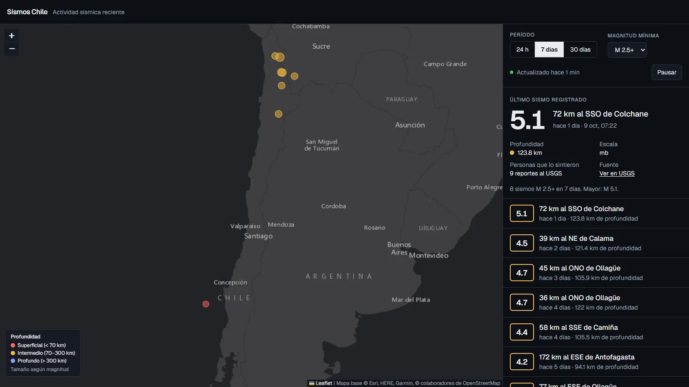
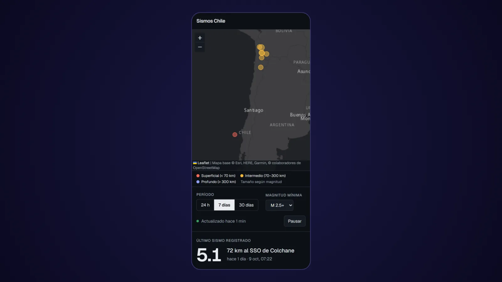

# Sismos Chile

Mapa y lista de los sismos recientes en Chile, actualizados cada minuto con datos del
[USGS](https://earthquake.usgs.gov/fdsnws/event/1/).

**Demo en vivo:** https://sismos-chile-rouge.vercel.app



<details>
<summary>Vista en celular</summary>



</details>

- Último sismo destacado, con magnitud, ubicación en español ("72 km al SSO de Colchane"), profundidad y hora de Chile.
- Mapa en relieve 3D de Chile (incluida la fosa de Atacama) con círculos cuyo tamaño indica la magnitud y cuyo color indica la profundidad (superficial, intermedio, profundo); el sismo más reciente late como una onda sobre el relieve.
- Cronología con reproducción: repite el período elegido y cada sismo aparece con su onda; se puede pausar y arrastrar.
- Filtros por período (24 h, 7 días, 30 días) y magnitud mínima; actualización automática que se puede pausar.
- Al seleccionar un sismo en la lista, el mapa se centra en él y abre su detalle.

## Stack

Next.js 16 (App Router, Cache Components) · React 19 · TypeScript · Tailwind CSS 4 · TanStack Query · MapLibre GL · Zod

## Desarrollo

Requiere Node.js 20.9 o superior (se recomienda 22 LTS).

```powershell
npm install
npm run dev      # http://localhost:3000
npm run lint
npm run build    # compilación de producción; valida tipos y prerender
```

No necesita variables de entorno ni API keys.

## Cómo funciona

| Pieza | Archivo | Qué hace |
|---|---|---|
| Datos | `lib/usgs.ts` | Consulta el servicio FDSN del USGS para un rectángulo que cubre Chile, valida la respuesta con Zod y descarta los sismos ocurridos en países vecinos. Cachea el resultado 60 s con `"use cache"`. |
| Traducción | `lib/lugar.ts` | Convierte "72 km SSW of Colchane, Chile" en "72 km al SSO de Colchane". |
| API | `app/api/sismos/route.ts` | `GET /api/sismos?periodo=dia\|semana\|mes`, que el navegador consulta cada minuto. |
| Página | `app/page.tsx` | Se prerenderiza con los sismos de los últimos 7 días y se revalida cada minuto. |
| Interfaz | `components/Explorador.tsx` | Filtros, estado de actualización, cronología, lista y mapa (MapLibre se carga solo en el navegador). |

### Decisiones técnicas

- **USGS y no CSN**: el Centro Sismológico Nacional no publica una API pública documentada. El USGS sí, pero en Chile registra principalmente sismos de magnitud 4 o superior, y la app lo indica.
- **Hora calculada en el servidor**: con Cache Components, Next prerenderiza también los componentes de cliente. Si TanStack Query lee la hora durante el render, esa parte se aplaza al navegador. Por eso el servidor envía `obtenidoEn` junto con los datos y la consulta usa `staleTime: "static"`; la actualización depende solo de `refetchInterval`.
- **Fechas en 24 h y con espacios normalizados**: Node y los navegadores traen versiones distintas de ICU y pueden formatear con espacios diferentes, lo que rompe la hidratación de React.
- **Relieve sin API key**: el mar viene del mapa de océanos de Esri y la elevación, con batimetría, de las teselas Terrarium de Mapzen en AWS. CARTO, en cambio, ahora exige key.
- **Worker de MapLibre en `public/maplibre/`**: Turbopack no resuelve el worker de la librería, así que se sirve como archivo estático (copia de `node_modules/maplibre-gl/dist/maplibre-gl-worker.mjs`); hay que actualizarlo al actualizar `maplibre-gl`.

## Aviso

Este sitio no es un sistema oficial de alerta. Ante una emergencia sigue las indicaciones de
[SENAPRED](https://senapred.cl/) y el [SHOA](https://www.shoa.cl/).

## Autor

**Héctor Sanhueza**: [GitHub](https://github.com/JS-Ranker) · [LinkedIn](https://www.linkedin.com/in/hectorsanhueza/)
